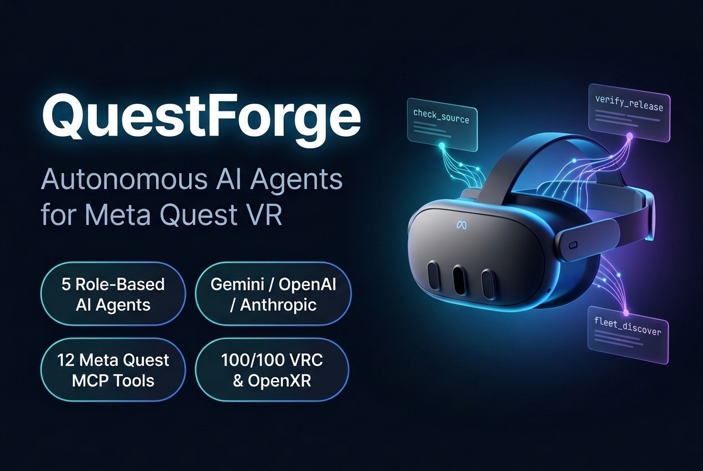

# QuestForge

**Autonomous, role-based AI agents for Meta Quest & Meta Horizon OS** — guiding VR teams from first project setup to `100/100` store readiness and headset rollout.

---

## Why QuestForge?

Shipping on **Meta Quest** shouldn't mean wrestling with OpenXR permissions, brittle SDK setups, or last-minute Meta Horizon Store rejections.

QuestForge puts autonomous AI agents (`Gemini`, `OpenAI`, `Anthropic`) in charge of the tedious engineering, compliance, and release work—so XR creators and studios can focus on worlds, presence, and gameplay.

---

## Role-Based AI Agents

Every person on a VR team has different priorities. QuestForge adapts to your role:

| AI Agent Role | Built For | What It Handles |
|---|---|---|
| **Studio** | XR Game Teams | Project scaffolding, OpenXR feature sync, build checks & store readiness |
| **QA & Release** | QA & Release Managers | `0–100` Meta Horizon VRC readiness scorecards, lab headset testing & store uploads |
| **Platform** | Platform & DevOps | Workstation parity, CI pipelines & automated build diagnostics |
| **Enterprise** | Training & Simulation | Supply-chain auditability, SBOMs & fleet rollout to enterprise headsets |
| **Developer** | AI-Native XR Creators | Interactive copilot across the entire QuestForge toolset |

---

## Getting Started

Ready to try QuestForge?

- **[Quick Start Guide](docs/quickstart.md)** — Install QuestForge on Windows or Linux / WSL, connect your AI provider, and launch your first agent in minutes.
- **[Overview & Documentation](docs/overview.md)** — Explore the full product concept, architecture, workflows, developer guide, and operations runbook.
