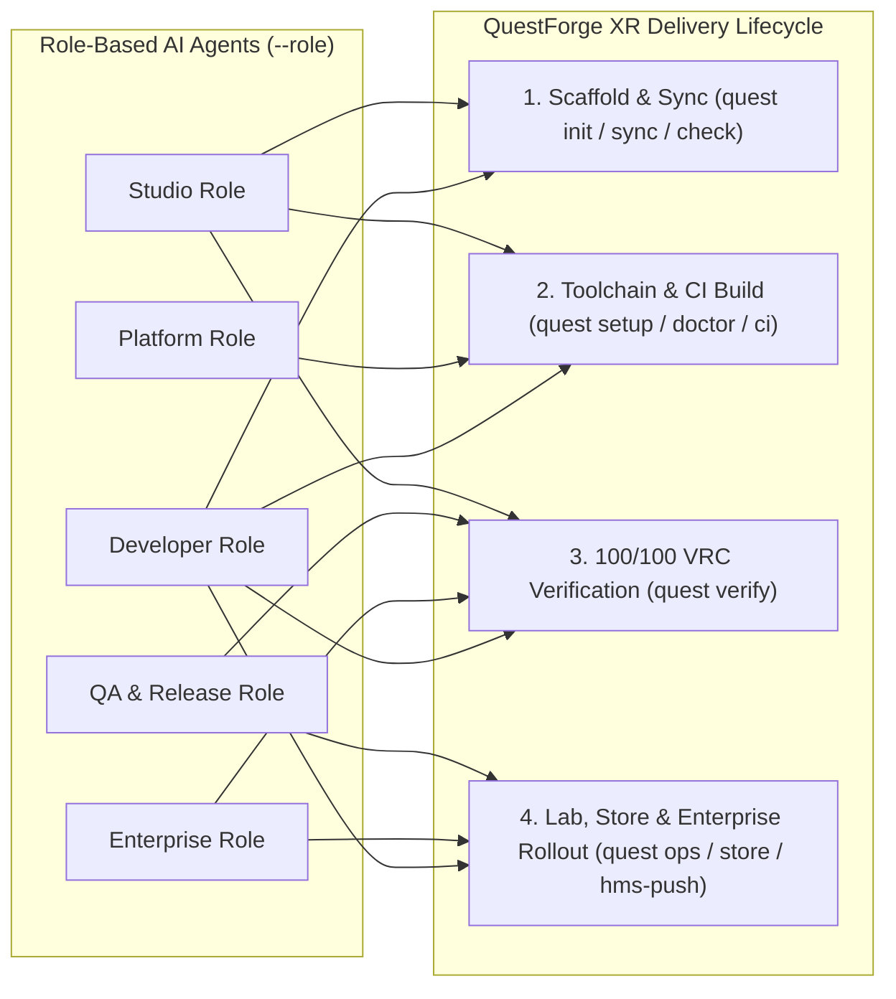

# QuestForge — Product Concept & Target Audiences

**Audience**: Product leads, XR studio directors, enterprise buyers, and QuestForge contributors

## Table of Contents

- [Concept Summary](#concept-summary)
- [Value Proposition](#value-proposition)
- [Target Audiences](#target-audiences)
- [Product Packaging & Positioning](#product-packaging--positioning)
- [Supported Engines & Roadmap](#supported-engines--roadmap)

## Concept Summary

**QuestForge** is the **DevSecOps and Release Engineering Platform for Meta Quest and Meta Horizon OS**—the missing automation, verification, and governance layer between Unity/Unreal source code and the Meta Horizon Store or enterprise MDM systems.

It unifies project scaffolding, zero-trust toolchain provisioning, environment diagnostics, CI/CD build orchestration, static APK/VRC compliance verification, MCP AI-agent tooling, lab fleet operations, and a hosted control plane into a single Rust CLI (`quest`) and `machineweb` (`mweb`) web dashboard.

---

## Value Proposition

- **Eliminate Onboarding & Environment Drift:** Turn fragile Unity/Unreal + JDK + Android SDK/NDK + Meta XR SDK + OpenXR setups into a repeatable, fail-fast checklist (`quest init`, `quest setup`, `quest doctor`).
- **Catch Store Rejections Pre-Upload:** Statically verify `.apk` integrity, v1/v2+ signatures, `arm64-v8a` compliance, Meta VRC manifest rules, permissions, and size limits before submission (`quest verify`).
- **Zero-Trust & Supply-Chain Ready:** Enforce SHA-256 verification on provisioned binaries, emit CycloneDX 1.5 SBOMs and SARIF reports, and enforce RBAC/JWT + immutable audit logs in the control plane (`quest serve`).
- **Vendor-Agnostic Execution:** Run locally or in any CI provider (`scripts/ci.sh`, GitHub Actions, Azure DevOps, Jenkins) with zero CI vendor lock-in.

---

## Target Audiences

### 1. XR Game Studios (Unity & Unreal Teams)
- **Role:** Primary CLI & CI adopters.
- **Pain Points:** Brittle local SDK setups, slow CI pipeline configuration, and unexpected Meta Horizon Store VRC rejections.
- **Capabilities Used:** `quest init`, `quest setup`, `quest doctor`, `quest ci`, `quest verify`.

### 2. Enterprise XR Training & Simulation Teams
*(Healthcare, Aviation, Manufacturing, Defense, Retail)*
- **Role:** Primary commercial / enterprise buyers.
- **Pain Points:** Supply-chain security compliance, release auditability, and deploying internal APKs to QA and training lab headsets.
- **Capabilities Used:** Zero-trust `quest setup`, CycloneDX SBOMs, `quest serve` (PostgreSQL + JWT/OIDC + RBAC + `/api/audit`), `web/` dashboard, and `quest ops agent`.

### 3. Platform & DevOps Engineers Supporting XR Organizations
- **Role:** Infrastructure owners and internal tooling maintainers.
- **Pain Points:** Maintaining Unity/Unreal Android builds across heterogeneous CI runners and enforcing architectural/repo standards.
- **Capabilities Used:** `quest_forge.yaml`, `quest doctor --ci`, `quest ci --emit-pipeline`, provider-agnostic `scripts/ci.sh`, and architecture compliance gates.

### 4. XR QA & Release Managers
- **Role:** Release gatekeepers and lab operators.
- **Pain Points:** Manual APK inspection, collecting device logs/screenshots by hand, and lack of release readiness visibility.
- **Capabilities Used:** `quest verify` scorecards (CLI, JSON, SARIF, HTML, PDF), `quest ops` (`discover`, `deploy`, `rollback`, `logcat`, `screenshot`), and the `web/` dashboard.

### 5. AI-Native XR Developers
- **Role:** Developers using AI coding agents and copilots.
- **Pain Points:** Cryptic Unity, IL2CPP, Gradle, and Android NDK build failures.
- **Capabilities Used:** `quest mcp` (`doctor_check`, `init_project`, `build_project`, `verify_release`, `generate_pipeline`, `analyze_build_failure`, `search_docs`).

---

## Product Packaging & Positioning

- **Developer Wedge (Free / Open-Source CLI):** `quest` (`init`, `setup`, `doctor`, `ci`, `verify`, `mcp`) drives bottom-up adoption.
- **Commercial / Enterprise Tier:** `quest serve` + `web/` control plane + `quest ops agent` (PostgreSQL persistence, JWT/OIDC + RBAC, immutable audit logs, compliance scorecards, and lab fleet orchestration).
- **Positioning Edge:** QuestForge **complements** kiosk MDMs (ManageXR, ArborXR, Meta Horizon Managed Services)—owning **build → verify → compliance → QA lab rollout**, while MDMs own end-user kiosk distribution.

---

## Supported Engines & Roadmap

### Shipped Today (v0.1)
1. **Unity (`engine: unity`)** — C# / IL2CPP + OpenXR (`com.unity.xr.openxr`) + Meta XR SDK (`com.meta.xr.sdk.all`), declarative `*.gen.cs` bootstrap and scene controller codegen.
2. **Unreal Engine (`engine: unreal`)** — C++ / Blueprints + OpenXR + `MetaXR`, declarative `*.gen.h` and `Config/DefaultEngine.ini` codegen.
3. **Native Rust OpenXR (`engine: rust`)** — Pure Rust (`1.100.0`) + `openxr` crate (`cdylib` targeting `aarch64-linux-android`), declarative `src/questforge_bootstrap_gen.rs` and `src/*_xr_scene_gen.rs` trait/dispatcher codegen.

### Roadmap (Tracked in Issue `#18`)
4. **Godot 4 OpenXR (`engine: godot`)** — `project.godot` + `godot_openxr_vendors` (Meta OpenXR Vendors plugin) + GDScript / `gdext` Rust scene codegen.
5. **Native C++ OpenXR Mobile SDK (`engine: cpp`)** — CMake + Gradle + Meta OpenXR Mobile SDK (`ovr_openxr_mobile_sdk`).
6. **WebXR / `wgpu` Progressive Web App (`engine: webxr`)** — `machineweb` (`mweb`) + Rust `wasm32-unknown-unknown` (`wgpu` + WebXR Device API) for Meta Quest Browser and Horizon Store PWA packaging.
