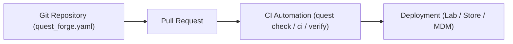

# QuestForge Platform

**Audience**: Architects, domain modellers, and platform engineers

> **TLDR**: Comprehensive Domain-Driven Design (DDD), product vision, use cases, bounded contexts, and architecture specification for the QuestForge Meta Quest and Meta Horizon OS DevSecOps ecosystem (`quest setup`, `quest doctor`, `quest init`, `quest sync`, `quest check`, `quest ci`, `quest verify`, `quest mcp`, `quest agent`, `quest ops`, and `quest serve`).

## Unified Product Vision, SRS, Use Cases, and Design Document
### Meta Quest / Meta Horizon OS DevOps & Developer Productivity Ecosystem

**Version:** 1.0  
**Author:** Amu

---

## Table of Contents

- [Executive Summary](#executive-summary)
- [Product Vision](#product-vision)
- [Design Principles](#design-principles)
- [Domain-Driven Design (DDD) & Bounded Contexts](#domain-driven-design-ddd)

---

# Executive Summary

QuestForge is an enterprise-grade DevOps, platform-engineering, automation, governance, and fleet-management ecosystem designed specifically for Meta Quest and Meta Horizon OS development.

The platform addresses common challenges experienced by XR development organizations:

- Environment setup complexity
- SDK compatibility management
- Build automation
- Release governance
- Compliance validation
- Multi-device deployment
- Fleet management
- AI-assisted development
- Enterprise onboarding

QuestForge consists of seven integrated products:

| Product | Purpose |
|----------|----------|
| setup-metavr | Meta VR CLI installation and provisioning |
| quest-doctor | Developer environment validation |
| quest-init | Project scaffolding and repository generation |
| quest-ci | Continuous Integration and Continuous Delivery |
| quest-verify | Release validation and compliance |
| quest-mcp | AI agent integration platform |
| questops | Quest fleet management |

Together these products provide a complete software delivery lifecycle for the Meta Quest ecosystem.

---

# Product Vision

Create the equivalent of:

- GitHub Actions for Quest
- Terraform for XR projects
- Backstage for Quest development
- FleetDM for Quest devices
- Flutter Doctor for Quest validation
- MCP-first AI development experience

The platform should enable:

- Faster onboarding
- Standardized development practices
- Repeatable builds
- Secure releases
- Device fleet governance
- Enterprise-level compliance
- AI-native workflows

---

# Design Principles

## DP-001 GitOps First

All configuration shall be stored in source control.



---

## DP-002 AI Native

Every system capability shall be exposed via:

```text
CLI
REST API
MCP
GitHub Actions
Web UI
```

---

## DP-003 Cloud Agnostic

Deployment shall support:

```text
AWS
Azure
GCP
On-premises
```

---

## DP-004 Modular First

Every component must be deployable independently.

```text
quest-init
quest-doctor
quest-ci
quest-verify
quest-mcp
questops
```

---

# High-Level Architecture

```text
Developers
      │
      ▼
QuestForge CLI
      │
      ▼
QuestForge API Gateway
      │
 ┌────┼─────┬─────┐
 ▼    ▼     ▼     ▼
CI Verify MCP QuestOps
 │    │     │
 └────┴─────┘
      │
      ▼
Meta VR CLI
      │
      ▼
Quest Hardware
      │
      ▼
Meta Horizon Store
```

---

# Product 1: Setup MetaVR

## Purpose

Provide a reliable and repeatable installation mechanism for the Meta VR CLI in local machines and CI environments.

## Functional Requirements

### SMV-001

Install Meta VR CLI.

### SMV-002

Support version pinning.

### SMV-003

Support Linux.

### SMV-004

Support Windows.

### SMV-005

Support macOS.

### SMV-006

Verify checksums.

### SMV-007

Support binary caching.

### SMV-008

Expose installed binary path.

---

## Architecture

### Components

```text
Version Resolver
Downloader
Checksum Validator
Cache Manager
Installer
```

### Workflow

```text
CI Workflow
      ↓
setup-metavr
      ↓
Resolve Version
      ↓
Download
      ↓
Verify
      ↓
Cache
      ↓
Install
```

---

## Use Cases

### UC-SMV-001 Provision Build Agent

Actor: CI Pipeline

Flow:

1. Workflow starts
2. setup-metavr executes
3. Version resolved
4. Binary downloaded
5. Integrity validated
6. PATH updated
7. Build continues

---

### UC-SMV-002 Version Pinning

Actor: Platform Engineer

Flow:

1. Engineer specifies version
2. Exact release installed
3. Reproducible build guaranteed

---

# Product 2: Quest Doctor

## Purpose

Validate environments before development or builds begin.

## Functional Requirements

### QD-001

Validate Java installation.

### QD-002

Validate Android SDK.

### QD-003

Validate Android NDK.

### QD-004

Validate Unity installation.

### QD-005

Validate Meta XR SDK.

### QD-006

Validate OpenXR.

### QD-007

Validate signing certificates.

### QD-008

Generate remediation guidance.

---

## Architecture

```text
Doctor Engine
      ↓
Validator Registry
      ↓
Validation Plugins
      ↓
Reporting Engine
```

---

## Plugin Interface

```rust
pub trait Validator {
    fn name(&self) -> &str;
    fn validate(&self) -> ValidationResult;
}
```

---

## Use Cases

### UC-QD-001 Developer Onboarding

Actor: Developer

Flow:

1. Install Quest Doctor
2. Execute validation
3. Verify dependencies
4. Report missing components
5. Provide remediation

---

### UC-QD-002 Enterprise Compliance Audit

Actor: IT Administrator

Flow:

1. Run validation across fleet
2. Collect reports
3. Detect noncompliance
4. Create remediation tickets

---

### UC-QD-003 CI Validation

Actor: Build System

Flow:

1. Execute pre-build validation
2. Detect missing dependencies
3. Fail fast if issues exist

---

# Product 3: Quest Init

## Purpose

Generate repositories and projects following organizational standards.

## Functional Requirements

### QI-001

Generate Unity projects.

### QI-002

Generate Unreal projects.

### QI-003

Generate GitHub Actions.

### QI-004

Generate documentation.

### QI-005

Generate governance artifacts.

### QI-006

Generate security policies.

### QI-007

Generate release workflows.

### QI-008

Generate CODEOWNERS.

---

## Architecture

```text
Template Engine
      ↓
Project Generator
      ↓
Policy Generator
      ↓
Repository Generator
```

---

## Use Cases

### UC-QI-001 Create New XR Project

Actor: Developer

Flow:

```text
quest-init my-app
```

Generates:

```text
src/
docs/
.github/
README.md
SECURITY.md
CODEOWNERS
```

---

### UC-QI-002 Enterprise Repository Bootstrap

Actor: Platform Team

Flow:

1. Select template
2. Generate repository
3. Create documentation
4. Create governance files
5. Create CI pipeline

---

### UC-QI-003 Multi-Team Project Creation

Actor: Program Manager

Flow:

1. Define teams
2. Generate ownership structure
3. Configure workflows
4. Configure governance rules

---

# Product 4: Quest CI

## Purpose

Automate build, testing, packaging, and release pipelines.

## Functional Requirements

### QCI-001

Build Unity projects.

### QCI-002

Build Unreal projects.

### QCI-003

Create APK artifacts.

### QCI-004

Generate build metadata.

### QCI-005

Generate SBOMs.

### QCI-006

Run tests.

### QCI-007

Publish artifacts.

### QCI-008

Support GitHub Actions, Azure DevOps, and Jenkins.

---

## Architecture

```text
Git Provider
      ↓
Build Orchestrator
      ↓
Unity Builder
      ↓
Artifact Generator
      ↓
Artifact Repository
```

---

## Pipeline

```text
Checkout
    ↓
Validate
    ↓
Compile
    ↓
Test
    ↓
Package
    ↓
Generate SBOM
    ↓
Publish
```

---

## Use Cases

### UC-QCI-001 Build APK

Actor: Developer

Flow:

1. Commit code
2. Trigger build
3. Compile project
4. Generate APK
5. Upload artifact

---

### UC-QCI-002 Pull Request Validation

Actor: Platform Engineer

Flow:

1. Open PR
2. Execute validation
3. Run tests
4. Block merge on failure

---

### UC-QCI-003 Production Release

Actor: Release Manager

Flow:

1. Create tag
2. Start release build
3. Generate signed APK
4. Publish release assets

---

# Product 5: Quest Verify

## Purpose

Validate release readiness and compliance.

## Functional Requirements

### QV-001

Validate APK integrity.

### QV-002

Validate signatures.

### QV-003

Validate SDK compatibility.

### QV-004

Validate package standards.

### QV-005

Analyze permissions.

### QV-006

Perform security scans.

### QV-007

Generate release reports.

### QV-008

Generate scorecards.

---

## Architecture

```text
APK Analyzer
      ↓
Policy Engine
      ↓
Security Scanner
      ↓
Compliance Reporter
```

---

## Verification Pipeline

```text
APK
 ↓
Metadata Extraction
 ↓
Signature Validation
 ↓
Policy Checks
 ↓
Security Checks
 ↓
Report
```

---

## Use Cases

### UC-QV-001 Release Readiness

Actor: Release Manager

Flow:

1. Upload APK
2. Perform validation
3. Generate report
4. Determine readiness

---

### UC-QV-002 Security Review

Actor: Security Engineer

Flow:

1. Scan release package
2. Detect vulnerabilities
3. Produce security findings

---

### UC-QV-003 Compliance Gate

Actor: Release Pipeline

Flow:

1. Validate release
2. Detect violations
3. Block deployment if required

---

# Product 6: Quest MCP

## Purpose

Expose Quest development capabilities to AI agents and copilots.

## Functional Requirements

### MCP-001

Search documentation.

### MCP-002

Build projects.

### MCP-003

Deploy applications.

### MCP-004

Validate SDKs.

### MCP-005

Generate pipelines.

### MCP-006

Analyze build failures.

### MCP-007

Retrieve telemetry.

### MCP-008

Generate project templates.

---

## Architecture

```text
AI Agent
      ↓
Quest MCP
      ↓
Tool Router
      ↓
QuestForge Services
```

---

## MCP Tools

```json
{
  "build_project": {}
}
```

```json
{
  "generate_pipeline": {}
}
```

```json
{
  "verify_release": {}
}
```

```json
{
  "deploy_apk": {}
}
```

---

## Use Cases

### UC-MCP-001 Documentation Search

Actor: Developer

Flow:

1. Ask question
2. Search documentation
3. Return results

---

### UC-MCP-002 Build Automation

Actor: AI Agent

Flow:

1. Invoke build tool
2. Execute build
3. Return status

---

### UC-MCP-003 AI Troubleshooting

Actor: Developer

Flow:

1. Supply build log
2. Analyze failure
3. Suggest resolution

---

### UC-MCP-004 Pipeline Generation

Actor: Developer

Flow:

1. Describe requirements
2. Generate workflow
3. Validate configuration

---

# Product 7: QuestOps

## Purpose

Provide fleet management and operational tooling for Quest devices.

## Functional Requirements

### QO-001

Register devices.

### QO-002

Collect inventory.

### QO-003

Monitor firmware.

### QO-004

Deploy APKs.

### QO-005

Rollback releases.

### QO-006

Collect logs.

### QO-007

Capture screenshots.

### QO-008

Monitor battery health.

### QO-009

Manage groups.

### QO-010

Schedule deployments.

---

## Architecture

```text
QuestOps API
        ↓
Device Controller
        ↓
Meta VR CLI
        ↓
Quest Devices
```

---

## Use Cases

### UC-QO-001 Register Device

Actor: Device Administrator

Flow:

1. Connect device
2. Discover device
3. Register inventory
4. Assign group

---

### UC-QO-002 Fleet Deployment

Actor: XR Operations Engineer

Flow:

1. Select APK
2. Select group
3. Schedule rollout
4. Verify installation

---

### UC-QO-003 Emergency Rollback

Actor: Release Manager

Flow:

1. Detect incident
2. Select previous version
3. Rollback deployment

---

### UC-QO-004 Screenshot Collection

Actor: QA Engineer

Flow:

1. Request screenshot
2. Device captures image
3. Retrieve artifact
4. Review results

---

### UC-QO-005 Battery Monitoring

Actor: Operations Team

Flow:

1. Collect telemetry
2. Analyze battery degradation
3. Generate replacement recommendations

---

# Data Architecture

## Project

```text
ProjectID
Name
Repository
Owner
CreatedDate
```

---

## Build

```text
BuildID
ProjectID
Status
Version
Timestamp
```

---

## Artifact

```text
ArtifactID
Version
SHA256
StoragePath
```

---

## Device

```text
DeviceID
SerialNumber
FirmwareVersion
Status
```

---

## Deployment

```text
DeploymentID
TargetGroup
Status
ArtifactID
```

---

# API Design

## Projects

```http
POST /api/projects
GET /api/projects
GET /api/projects/{id}
```

---

## Builds

```http
POST /api/builds
GET /api/builds/{id}
```

---

## Verification

```http
POST /api/verify
GET /api/reports/{id}
```

---

## Deployments

```http
POST /api/deployments
GET /api/deployments/{id}
```

---

# Security Architecture

## Authentication

```text
OIDC
GitHub OAuth
Azure AD
```

---

## Authorization

```text
RBAC
ABAC
```

Roles:

```text
Administrator
Platform Engineer
Developer
QA Engineer
Operations Engineer
Auditor
```

---

## Supply Chain Security

```text
Artifact Signing
SBOM Generation
Dependency Scanning
Cosign
SLSA
```

---

# Observability

## Metrics

```text
Build Success Rate
Deployment Success Rate
Validation Failures
Release Readiness Score
Fleet Availability
```

## Logging

```text
Structured JSON
Audit Logging
Correlation IDs
```

## Tracing

```text
OpenTelemetry
Tempo
Jaeger
```

---

# Scalability Requirements

```text
10,000 Repositories

100,000 Builds Per Month

10,000 Quest Devices

1,000 Concurrent Developers
```

---

# Deployment Architecture

## Kubernetes

```text
Ingress
   ↓
API Gateway
   ↓
Quest Services
   ↓
PostgreSQL
Redis
Object Storage
```

---

## Local Environment

```yaml
postgres
redis
quest-api
quest-ci
quest-verify
quest-mcp
questops
```

---

# Recommended Technology Stack

## Backend

```text
Rust (1.100.0)
```

Reasons:

- Fast startup & zero runtime dependencies
- Single static binaries
- Strong type safety for manifest, APK, and MCP tooling
- Excellent CLI ecosystem (`clap`, `serde`, `cargo-dist`)

---

## Architecture Enforcement

```text
Architecture & Layer Compliance Gate
```

Used to scaffold, audit, and auto-remediate QuestForge's Rust `1.100.0` crates and workspaces (`cli`, `api`, `std`, `spi`, `lib`, `gateway`, `handler`) against Architecture 4.0 invariant rules, configured via `config/vocabulary.toml` (or `vocabulary.toml`).

---

## Frontend

```text
machineweb (mweb) — *_component.yaml (dom / styles / address) -> Web Components
TypeScript (7.0.2, native)
Bun (1.4.2, latest stable)
```

---

## Storage

```text
PostgreSQL
Redis
S3-Compatible Storage
```

---

## Messaging

```text
NATS
```

---

## Observability

```text
Prometheus
Grafana
Loki
Tempo
OpenTelemetry
```

---

# End-to-End Enterprise Lifecycle

```text
quest-init
      ↓
quest-doctor
      ↓
setup-metavr
      ↓
quest-ci
      ↓
quest-verify
      ↓
quest-mcp
      ↓
questops
```

---

# Product Roadmap

## Phase 1 (Foundation)

```text
setup-metavr
quest-doctor
quest-init
```

## Phase 2 (Delivery)

```text
quest-ci
quest-verify
```

## Phase 3 (AI)

```text
quest-mcp
```

## Phase 4 (Operations)

```text
questops
```

## Phase 5 (Enterprise SaaS)

```text
Hosted QuestForge Platform
Managed Fleet Operations
Marketplace
Commercial Support
Multi-Tenant Architecture
```

---

# Success Metrics

- 80% onboarding reduction
- 60% fewer build failures
- 50% faster releases
- 90% CI/CD adoption
- Enterprise-grade XR governance
- AI-native development workflow support

# Conclusion

QuestForge provides an end-to-end platform for Meta Quest and Meta Horizon OS development, enabling organizations to standardize project creation, automate builds, validate releases, integrate AI agents, and operate Quest device fleets through a unified DevOps experience.