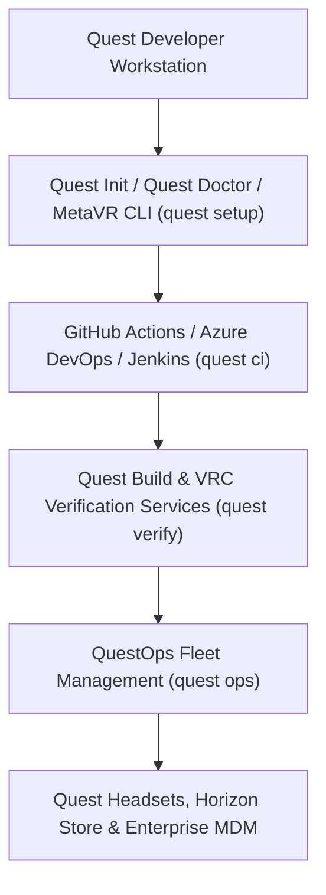

# Software Requirements Specification (SRS)

# Meta Quest DevOps Platform Suite

Version: 1.0

Author: Amu

## 1. Executive Summary

The Meta Quest DevOps Platform Suite is a collection of developer productivity, CI/CD, automation, governance, and fleet-management tools designed specifically for the Meta Horizon OS and Meta Quest development ecosystem.

The suite addresses challenges faced by Quest developers, including environment setup, build automation, deployment consistency, SDK compatibility, device management, release orchestration, and AI-assisted development.

The platform is comprised of seven products:

1. Meta Quest CI
2. Setup MetaVR GitHub Action
3. Quest Doctor
4. QuestOps Fleet Manager
5. Build Verification Platform
6. Quest MCP Enterprise Server
7. Quest Init Scaffolding Framework

---

# 2. Product Vision

Create the equivalent of:

- GitHub Actions for Quest
- kubectl for Quest operations
- Terraform-style automation for Quest environments
- Flutter Doctor for Quest validation
- Enterprise fleet management for Quest devices

Goals:

- Reduce onboarding time
- Standardize build pipelines
- Enable enterprise adoption
- Improve release reliability
- Support AI-native workflows
- Support multi-team governance

---

# 3. Stakeholders

## Primary

- Quest Developers
- Unity Developers
- Unreal Developers
- DevOps Engineers
- Platform Engineers
- QA Engineers

## Secondary

- Enterprise IT
- Training Organizations
- XR Operations Teams
- Managed Device Administrators

---

# 4. System Architecture

Meta Quest DevOps Platform Suite



---

# Product 1: Meta Quest CI

## Purpose

Provide reusable CI/CD workflows for Quest applications.

## Functional Requirements

### MQCI-001

System shall build Unity applications in CI.

### MQCI-002

System shall build Unreal applications in CI.

### MQCI-003

System shall create signed APK artifacts.

### MQCI-004

System shall publish build artifacts.

### MQCI-005

System shall generate release metadata.

### MQCI-006

System shall support:

- GitHub Actions
- Azure DevOps
- Jenkins

### MQCI-007

System shall generate SBOMs.

### MQCI-008

System shall scan dependencies for vulnerabilities.

## Non-Functional Requirements

- Build reproducibility
- Parallel execution
- Build caching
- Multi-platform support

---

# Product 2: Setup MetaVR GitHub Action

## Purpose

Provide a standardized installation mechanism for MetaVR CLI within CI environments.

## Functional Requirements

### SMV-001

Install MetaVR CLI.

### SMV-002

Support version pinning.

### SMV-003

Support Linux.

### SMV-004

Support Windows.

### SMV-005

Support macOS.

### SMV-006

Perform integrity verification.

### SMV-007

Expose installed binary path.

### SMV-008

Cache downloaded binaries.

## Inputs

```yaml
metavr-version: latest
cache: true
```

## Outputs

```yaml
metavr-path
metavr-version
```

---

# Product 3: Quest Doctor

## Purpose

Validate developer workstations before build execution.

## Functional Requirements

### QD-001

Validate Java installation.

### QD-002

Validate Android SDK installation.

### QD-003

Validate Android NDK installation.

### QD-004

Validate Unity installation.

### QD-005

Validate Meta SDK installation.

### QD-006

Validate OpenXR configuration.

### QD-007

Validate signing certificates.

### QD-008

Generate remediation guidance.

## Example Output

```text
✓ Java
✓ Android SDK
✓ OpenXR
✗ Meta XR SDK Missing
```

---

# Product 4: QuestOps Fleet Manager

## Purpose

Manage large fleets of Quest devices.

## Functional Requirements

### QO-001

Register devices.

### QO-002

Collect inventory.

### QO-003

Track firmware versions.

### QO-004

Deploy APKs.

### QO-005

Rollback APKs.

### QO-006

Capture logs.

### QO-007

Collect screenshots.

### QO-008

Monitor battery health.

### QO-009

Manage device groups.

### QO-010

Schedule deployments.

## Dashboard Features

- Device Inventory
- Deployment Status
- Firmware Status
- Battery Monitoring
- Usage Statistics

---

# Product 5: Build Verification Platform

## Purpose

Verify application readiness before release.

## Functional Requirements

### BVP-001

Validate APK integrity.

### BVP-002

Validate signatures.

### BVP-003

Validate SDK compatibility.

### BVP-004

 Validate package naming standards.

### BVP-005

Validate permissions.

### BVP-006

Run policy compliance checks.

### BVP-007

Generate release reports.

### BVP-008

Generate release scorecards.

## Compliance Reports

Generate:

- HTML
- PDF
- JSON
- SARIF

---

# Product 6: Quest MCP Enterprise Server

## Purpose

Expose Quest development capabilities to AI agents.

## Functional Requirements

### MCP-001

Provide document search tools.

### MCP-002

Provide build tools.

### MCP-003

Provide deployment tools.

### MCP-004

Provide SDK validation tools.

### MCP-005

Provide project generation tools.

### MCP-006

Provide telemetry retrieval.

### MCP-007

Provide pipeline generation.

## MCP Tool Examples

```json
{
  "name": "generate_pipeline"
}
```

```json
{
  "name": "build_project"
}
```

```json
{
  "name": "deploy_apk"
}
```

---

# Product 7: Quest Init Scaffolding Framework

## Purpose

Standardize project creation.

## Functional Requirements

### QI-001

Generate Unity projects.

### QI-002

Generate Unreal projects.

### QI-003

Generate repository templates.

### QI-004

Generate documentation.

### QI-005

Generate GitHub Actions.

### QI-006

Generate CODEOWNERS.

### QI-007

Generate Security Policies.

### QI-008

Generate Release Workflows.

## Example

```bash
quest-init my-app
```

Generated Structure:

```text
.github/
docs/
src/
CODEOWNERS
CONTRIBUTING.md
SECURITY.md
README.md
```

---

# Security Requirements

## SEC-001

Support signed artifacts.

## SEC-002

Support secret scanning.

## SEC-003

Support supply-chain validation.

## SEC-004

Support SBOM generation.

## SEC-005

Support role-based access control.

## SEC-006

Support audit logging.

---

# Scalability Requirements

## SCL-001

Support 10,000 repositories.

## SCL-002

Support 100,000 builds per month.

## SCL-003

Support 10,000 managed Quest devices.

## SCL-004

Support multi-region deployments.

---

# Future Roadmap

Phase 1:
- setup-metavr
- quest-doctor
- quest-init

Phase 2:
- meta-quest-ci
- build-verification-platform

Phase 3:
- quest-mcp-enterprise

Phase 4:
- questops-fleet-manager

---

# Success Metrics

- 80% reduction in onboarding effort
- 60% reduction in build failures
- 90% CI pipeline adoption
- 50% faster releases
- Enterprise-ready governance for XR development

End of Document