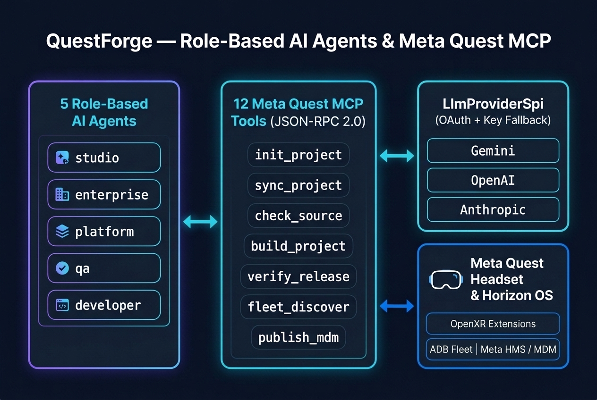
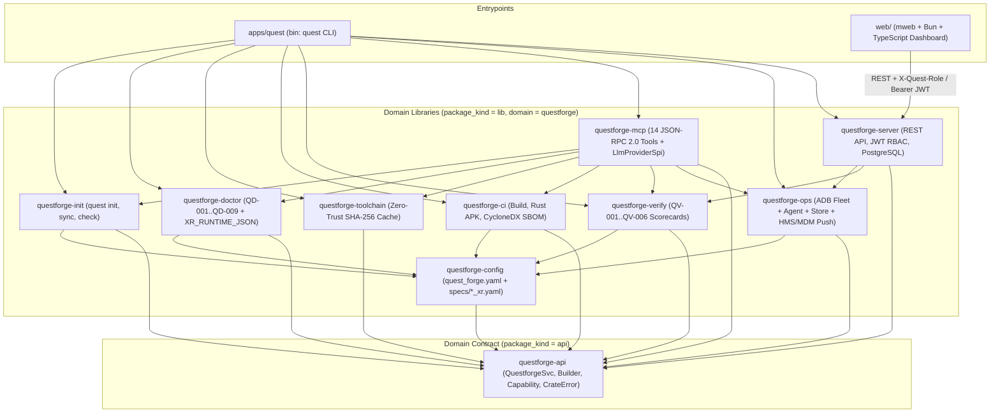
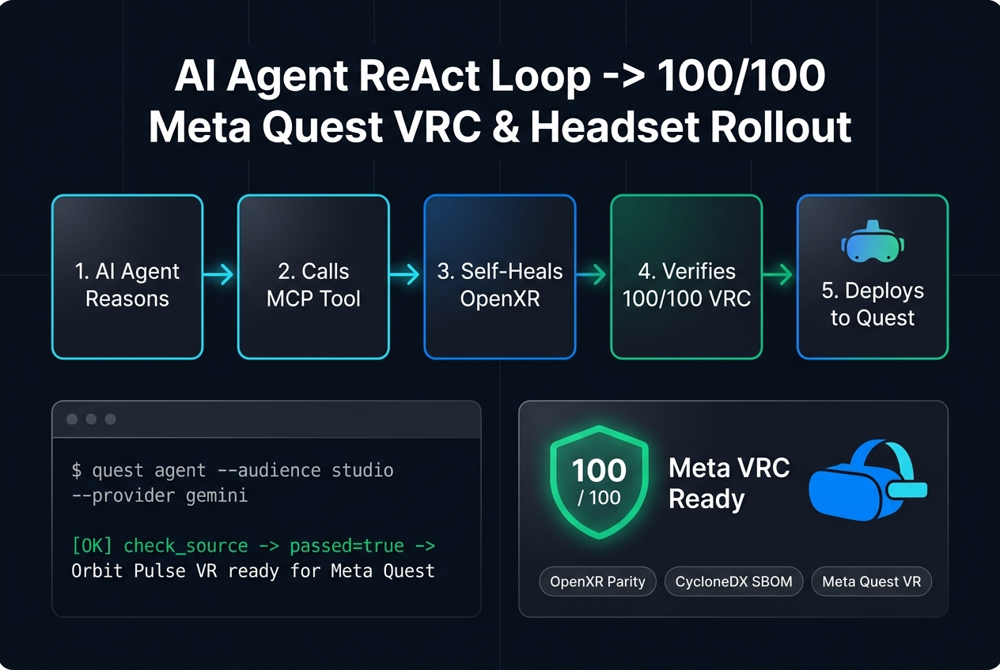
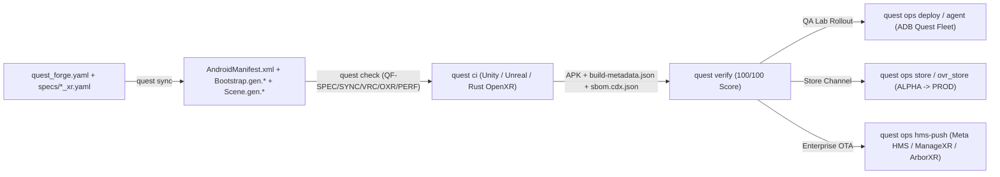
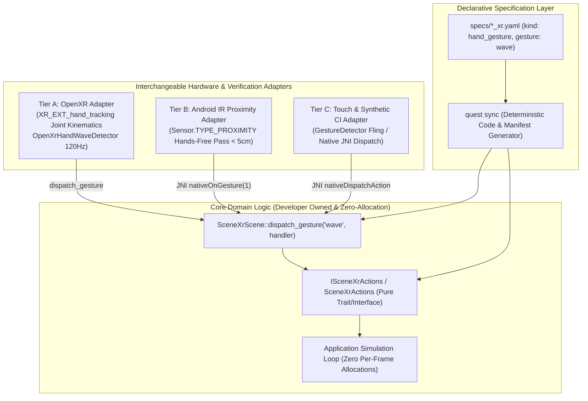
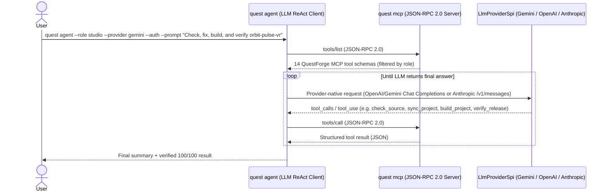
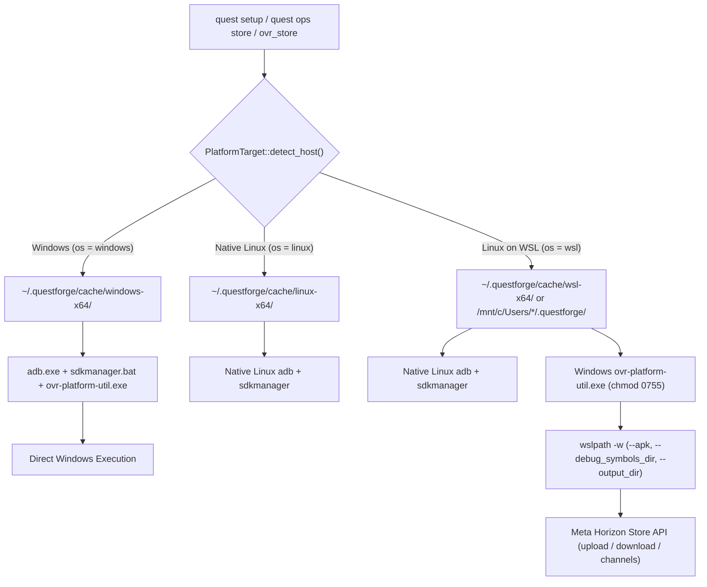
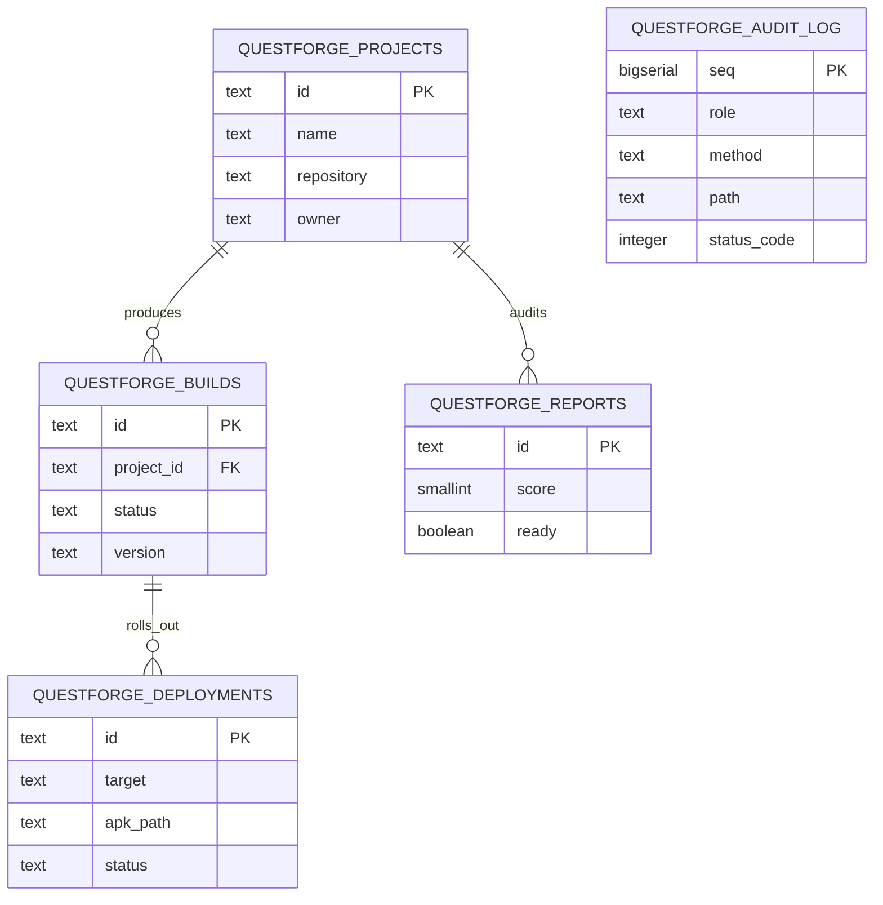

# QuestForge Architecture

**Audience**: Architects, technical leads, platform engineers, security reviewers, and QuestForge contributors

> [!NOTE]
> **TL;DR**: QuestForge is a stratified 11-package Rust workspace delivering a declarative, zero-trust developer platform, CI/CD pipeline, and AI agent orchestrator for Meta Quest. It decouples spatial computing domain logic from vendor SDKs and physical hardware via a hexagonal input architecture ([ADR-002](adr/002_stratified_input_and_gesture_kinematics.md)).

## Table of Contents

- [Overview](#overview)
- [Stakeholders & Concerns](#stakeholders--concerns)
- [Component & Layer Diagram](#component--layer-diagram)
- [End-to-End Data Flow (Code → Horizon OS → Meta Horizon Store & HMS)](#end-to-end-data-flow-code--horizon-os--meta-horizon-store--hms)
- [Stratified Input Architecture & Hexagonal Gesture Layer](#stratified-input-architecture--hexagonal-gesture-layer)
- [AI / LLM Agent Interaction Flow (`quest agent` ↔ `quest mcp`)](#ai--llm-agent-interaction-flow-quest-agent--quest-mcp)
- [Cross-Platform & WSL Interop Architecture](#cross-platform--wsl-interop-architecture)
- [Control Plane & Persistence Schema (`questforge-server`)](#control-plane--persistence-schema-questforge-server)
- [Layer Responsibilities](#layer-responsibilities)
- [Integration Points](#integration-points)
- [See Also](#see-also)

## Overview

QuestForge is organized as a stratified 11-package Rust workspace (`1.100.0`) paired with a `machineweb` (`mweb`) TypeScript frontend (`web/`). It separates domain contracts (`api`), cohesive domain libraries (`lib`), the CLI binary (`bin`), and external execution targets (Unity, Unreal, Native Rust OpenXR, ADB QA fleets, Meta Horizon Store, and Meta HMS/MDMs).

## Stakeholders & Concerns

| Stakeholder | Concerns |
|---|---|
| **XR Developers** | Zero boilerplate, fast local checks (`quest check`), multi-engine parity (`unity`, `unreal`, `rust`) |
| **AI Coding Agents** | Deterministic JSON-RPC 2.0 MCP tools (`quest mcp`) and structured diagnostics |
| **Platform & DevOps** | Provider-agnostic CI (`scripts/ci.sh`), CycloneDX SBOMs, SARIF gates, architecture compliance |
| **QA & Release Managers** | Pre-upload VRC scorecards (`quest verify`), ADB lab rollouts, instant rollbacks |
| **Enterprise Ops & Security** | Zero-trust SHA-256 tooling, JWT RBAC, PostgreSQL audit logs, Meta HMS / MDM handoff |

## Component & Layer Diagram

## End-to-End Data Flow (Code → Horizon OS → Meta Horizon Store & HMS)

## Stratified Input Architecture & Hexagonal Gesture Layer

A core architectural breakthrough of QuestForge is **Ports & Adapters (Hexagonal Architecture) for Spatial Computing**, codified in [ADR-002](adr/002_stratified_input_and_gesture_kinematics.md). Rather than coupling gameplay code directly to vendor OpenXR headset SDKs, QuestForge decouples declarative interaction contracts (`specs/*_xr.yaml`) from the underlying physical or synthetic hardware sensor source.

### Benefits of the Stratified Input Pattern:
1. **Zero-Hardware Evaluation:** Hackathon evaluators and developers without a Meta Quest headset can physically wave a hand over any standard Android phone's IR proximity sensor to test gesture mechanics hands-free.
2. **Headless Cloud CI:** Cloud runners (GitHub Actions) execute synthetic gesture verification in headless Android AVDs (`mobile-emulator`) without human touch or physical optical camera rigs.
3. **Enterprise Dual-Surface Mode:** The exact same release APK operates seamlessly as an immersive 6DoF spatial VR application on Quest or as a 2D supervisor / companion kiosk screen on mobile devices without maintaining divergent codebases.

## AI / LLM Agent Interaction Flow (`quest agent` ↔ `quest mcp`)

Every autonomous and LLM-driven agent interaction routes strictly through `quest mcp` over JSON-RPC 2.0 (`initialize` → `tools/list` → `tools/call`), with provider credentials and wire formats abstracted behind `LlmProviderSpi` (`GeminiProvider`, `OpenAiProvider`, `AnthropicProvider`) and tailored via `--role` (`studio`, `enterprise`, `platform`, `qa`, `developer`):

- **Auth & Fallback (`quest auth` / `--auth`):** OAuth-first (`gcloud` ADC/OAuth for Gemini, `~/.codex/auth.json` for OpenAI, `~/.claude/.credentials.json` for Anthropic), falling back to environment API keys (`GEMINI_API_KEY` / `GOOGLE_API_KEY`, `OPENAI_API_KEY`, `ANTHROPIC_API_KEY`) or an interactive API-key prompt when OAuth fails.
- **Linux via WSL Interop (`questforge-toolchain` & `questforge-ops`):** Because Meta does not ship a native Linux `ovr-platform-util`, QuestForge detects WSL (`PlatformTarget { os: "wsl", .. }`), provisions native Linux `adb`/`cmdline-tools` alongside Meta's Windows `ovr-platform-util.exe` (`chmod 0755`), reuses any existing Windows host cache under `/mnt/c/Users/*/.questforge/`, and transparently translates Linux paths via `wslpath -w` when invoking `ovr-platform-util.exe`.

## Cross-Platform & WSL Interop Architecture

## Control Plane & Persistence Schema (`questforge-server`)

## Layer Responsibilities

| Layer | Purpose | Rules |
|---|---|---|
| **`api` (`questforge-api`)** | Domain service, builder, capability traits, and `CrateError` | No dependencies on `lib` crates |
| **`lib` (`questforge-*`)** | Domain logic in private `vo/` & `error/`, re-exported at `lib.rs` | Must depend on `questforge-api`; `compile_fail` doctests enforce module privacy |
| **`bin` (`apps/quest`)** | Thin CLI command dispatch via `clap` | Orchestrates `lib` crates; no business logic |
| **`web/` (`mweb`)** | Declarative `dashboard_*.yaml` → TypeScript UI | Audited by `mweb check --browser` |

## Integration Points

| System | Integration | Purpose |
|---|---|---|
| **Meta Horizon OS OpenXR** | Generated `XR_FB_*` / `XR_EXT_*` extensions + `AndroidManifest.xml` | 72/90/120 Hz, Passthrough, Hand Tracking, Foveation, Spatial Anchors |
| **Meta Horizon Store** | `ovr-platform-util` (`quest ops store`, `quest ops store-upload`, `ovr_store`, `upload_store`, `quest ci`) | Automated store channel upload, download, and promotion (`ALPHA` → `PRODUCTION`) |
| **Meta HMS / ManageXR / ArborXR** | HTTPS JSON push (`quest ops hms-push` / `publish_mdm` via `mdm:` in `quest_forge.yaml`) | Enterprise OTA kiosk distribution (`graph.oculus.com`, `managexrapi.com`, `api.xrdm.app`) |
| **PostgreSQL** | `PostgresStore` (`quest serve --database-url`) | Persistent `questforge_projects`, `questforge_builds`, `questforge_reports`, `questforge_deployments`, `questforge_audit_log` |

## See Also

- [Architecture Compliance Checklist](compliance/compliance_checklist.md)
- [Architecture Decision Records (`3-design/adr/`)](adr/README.md)
- [Role Workflows (`3-design/workflow/`)](workflow/README.md)
- [Documentation Hub (`docs/README.md`)](../README.md)
