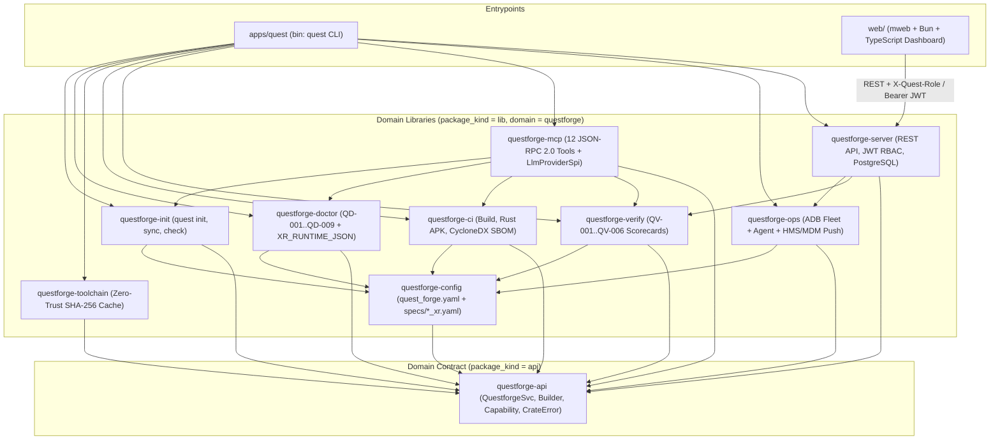
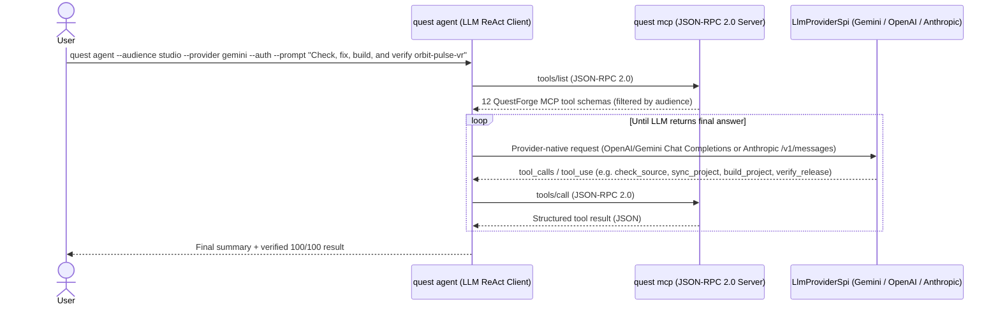

# QuestForge Architecture

## Overview

QuestForge is organized under **`swartch` Architecture 4.0** as an 11-package Rust workspace (`1.100.0`) paired with a `machineweb` (`mweb`) TypeScript frontend (`web/`). It separates domain contracts (`api`), cohesive domain libraries (`lib`), the CLI binary (`bin`), and external execution targets (Unity, Unreal, Native Rust OpenXR, ADB QA fleets, and Meta HMS/MDMs).

## Stakeholders & Concerns

| Stakeholder | Concerns |
|---|---|
| **XR Developers** | Zero boilerplate, fast local checks (`quest check`), multi-engine parity (`unity`, `unreal`, `rust`) |
| **AI Coding Agents** | Deterministic JSON-RPC 2.0 MCP tools (`quest mcp`) and structured diagnostics |
| **Platform & DevOps** | Provider-agnostic CI (`scripts/ci.sh`), CycloneDX SBOMs, SARIF gates, `swartch` compliance |
| **QA & Release Managers** | Pre-upload VRC scorecards (`quest verify`), ADB lab rollouts, instant rollbacks |
| **Enterprise Ops & Security** | Zero-trust SHA-256 tooling, JWT RBAC, PostgreSQL audit logs, Meta HMS / MDM handoff |

## Component & Layer Diagram

## End-to-End Data Flow (Code → Horizon OS → Meta HMS)

## AI / LLM Agent Interaction Flow (`quest agent` ↔ `quest mcp`)

Every autonomous and LLM-driven agent interaction routes strictly through `quest mcp` over JSON-RPC 2.0 (`initialize` → `tools/list` → `tools/call`), with provider credentials and wire formats abstracted behind `LlmProviderSpi` (`GeminiProvider`, `OpenAiProvider`, `AnthropicProvider`) and tailored via `--audience` (`studio`, `enterprise`, `platform`, `qa`, `developer`):

- **Auth & Fallback (`quest auth` / `--auth`):** OAuth-first (`gcloud` ADC/OAuth for Gemini, `~/.codex/auth.json` for OpenAI, `~/.claude/.credentials.json` for Anthropic), falling back to environment API keys (`GEMINI_API_KEY` / `GOOGLE_API_KEY`, `OPENAI_API_KEY`, `ANTHROPIC_API_KEY`) or an interactive API-key prompt when OAuth fails.

## Layer Responsibilities

| Layer | Purpose | Rules (`swartch`) |
|---|---|---|
| **`api` (`questforge-api`)** | Domain service, builder, capability traits, and `CrateError` | No dependencies on `lib` crates |
| **`lib` (`questforge-*`)** | Domain logic in private `vo/` & `error/`, re-exported at `lib.rs` | Must depend on `questforge-api`; `compile_fail` doctests enforce module privacy |
| **`bin` (`apps/quest`)** | Thin CLI command dispatch via `clap` | Orchestrates `lib` crates; no business logic |
| **`web/` (`mweb`)** | Declarative `dashboard_*.yaml` → TypeScript UI | Audited by `mweb check --browser` and `csslense` |

## Integration Points

| System | Integration | Purpose |
|---|---|---|
| **Meta Horizon OS OpenXR** | Generated `XR_FB_*` / `XR_EXT_*` extensions + `AndroidManifest.xml` | 72/90/120 Hz, Passthrough, Hand Tracking, Foveation, Spatial Anchors |
| **Meta Horizon Store** | `ovr-platform-util upload-quest-build` (`quest ci`) | Automated store channel promotion |
| **Meta HMS / ManageXR / ArborXR** | HTTPS JSON push (`quest ops hms-push` via `mdm:` in `quest_forge.yaml`) | Enterprise OTA kiosk distribution (`graph.oculus.com`, `managexrapi.com`, `api.xrdm.app`) |
| **PostgreSQL** | `PostgresStore` (`quest serve --database-url`) | Persistent projects, builds, reports, deployments, audit log |
