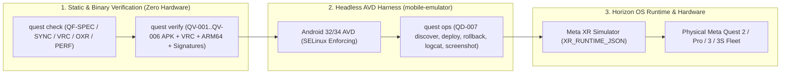

# Mobile Emulator Integration Plan (`mobile-emulator`)

**Audience**: Platform engineers, QA leads, and QuestForge contributors

**Related Issue:** `#6`  
**Reference:** `../mobile-emulator` (`docs/3-design/architecture.md`, `docs/3-design/adr/0018-android-emulator-for-ci-and-local-dev.md`)

---

## Table of Contents

- [1. Evaluation: What `mobile-emulator` Already Provides](#1-evaluation-what-mobile-emulator-already-provides)
- [2. Verification Boundary for QuestForge](#2-verification-boundary-for-questforge)
- [3. Required Enhancements for QuestForge Reuse](#3-required-enhancements-for-questforge-reuse)
- [4. Follow-Up Links](#4-follow-up-links)

---

## 1. Evaluation: What `mobile-emulator` Already Provides

`sweengineeringlabs/mobile-emulator` is a test-only headless Android AVD CI harness that proves:
1. **Standalone `cmdline-tools` provisioning** (`platform-tools`, `emulator`, `platforms;android-*`, `build-tools`, `system-images`, `ndk`) without Android Studio IDE weight.
2. **Headless AVD lifecycle:** Creating an AVD via `avdmanager`, booting with `-no-window -no-audio -no-boot-anim -gpu swiftshader_indirect -no-snapshot`, polling `adb wait-for-device` + `getprop sys.boot_completed == 1`, and tearing down unconditionally with `adb emu kill`.
3. **Production-like SELinux posture:** Using `google_apis_playstore` (non-rootable) and asserting `adb shell getenforce == Enforcing` before running app checks.
4. **Windows WHPX + Linux KVM compatibility:** Verified locally on Windows (WHPX) and designed for headless Linux runners.

---

## 2. Verification Boundary for QuestForge

| Verification Surface | Covered By | Notes |
|---|---|---|
| `adb` discovery (`QD-007`), `install`/rollback (`QO-004`, `QO-005`), `logcat` (`QO-006`), `screencap` (`QO-007`), SELinux `Enforcing` | **`mobile-emulator` AVD** | Real `adb` transport and Android package manager without physical hardware |
| APK integrity, v1/v2+ signatures, `arm64-v8a` ABI, Meta VRC `AndroidManifest.xml` flags, permissions, size | **`quest verify` (#8)** | Static binary/ZIP inspection; catches store blockers pre-upload |
| **Hand-Wave & Gesture Interaction Logic** | **`mobile-emulator` AVD + Physical Phone** | Verified via Android IR proximity sensor (`Sensor.TYPE_PROXIMITY`), touch swipe fallback, or JNI injection ([ADR-002](adr/002_stratified_input_and_gesture_kinematics.md)) |
| Horizon OS stereo XR rendering, optical 26-joint hand tracking, real headset `dumpsys` schemas | **Real Quest Hardware / Meta XR Simulator** | Standard Android AVDs lack Meta Horizon OS display server; `quest ops` (#10) pairs live AVD tests with mocked `dumpsys` fixtures |

---

## 3. Required Enhancements for QuestForge Reuse

1. **Provider-Agnostic Runner Script:**
   - Extract AVD create/boot/poll/teardown from `mobile-emulator`'s GitHub Actions YAML into a standalone `scripts/avd-smoke.sh` (consistent with QuestForge's provider-agnostic `scripts/int/ci.sh` strategy).
2. **Horizon OS–Aligned SDK Profile:**
   - Support `platforms;android-32` (`target_sdk: 32` default in `quest_forge.yaml`) alongside `android-34`, using `system-images;android-32;google_apis_playstore;x86_64` (or `arm64-v8a` on ARM64 hosts).
3. **Zero-Trust Provisioning Alignment:**
   - Align `cmdline-tools` installation with `quest setup` (`--cmdline-tools-version` + `--cmdline-tools-sha256`).
4. **External Harness Integration:**
   - Keep `mobile-emulator` as an external test harness (no `Cargo.toml` dependency from QuestForge crates) invoked optionally during Phase 4 (`quest ops`) integration runs.

---

## 4. Follow-Up Links

- **Phase 2 (`quest verify`, #8):** Static APK/VRC validation already covers manifest, signature, and `arm64-v8a` checks without an emulator.
- **Phase 4 (`quest ops`, #10):** Wire `quest ops` `adb` integration tests (`devices`, `install`, `uninstall`, `logcat`, `screencap`) to run against a booted `mobile-emulator` AVD when available, plus mocked `dumpsys` fixtures for Horizon OS telemetry.
