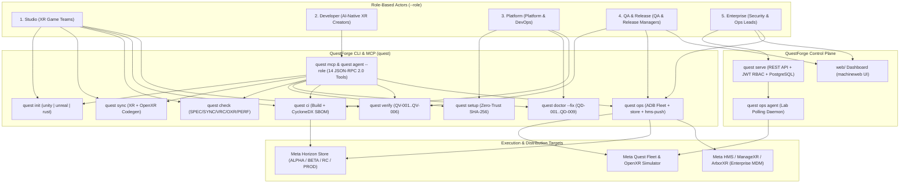

# QuestForge Role Workflows

Visual design workflows for the five role-based actors in the **QuestForge** ecosystem across **Meta Quest 2, Quest Pro, Quest 3, and Quest 3S (Meta Horizon OS)**.

---

## Multi-Role Ecosystem Overview

---

## Standalone Role Workflows

| Role (`--role`) | Target Persona | Workflow Document |
|---|---|---|
| **`studio`** | XR Game Teams (Unity, Unreal, Native Rust OpenXR) | [Studio Workflow](studio.md) |
| **`developer`** | AI-Native XR Creators & IDE Coding Agents | [Developer Workflow](developer.md) |
| **`platform`** | Platform & DevOps Engineers | [Platform Workflow](platform.md) |
| **`qa`** | XR QA & Release Managers | [QA & Release Workflow](qa.md) |
| **`enterprise`** | Enterprise Security, Compliance & Lab Operations Leads | [Enterprise Workflow](enterprise.md) |
