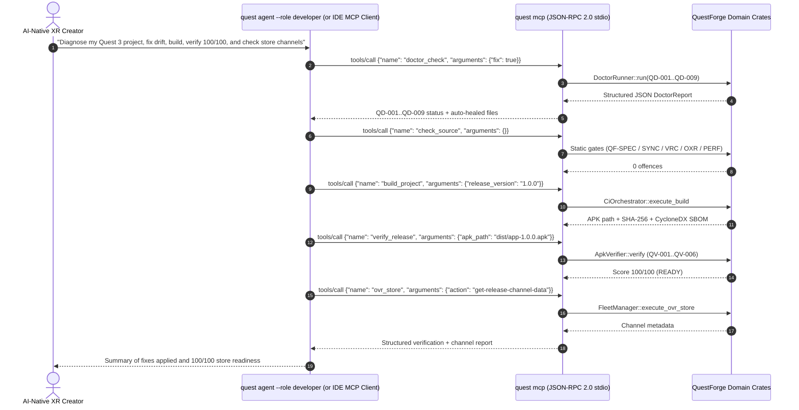
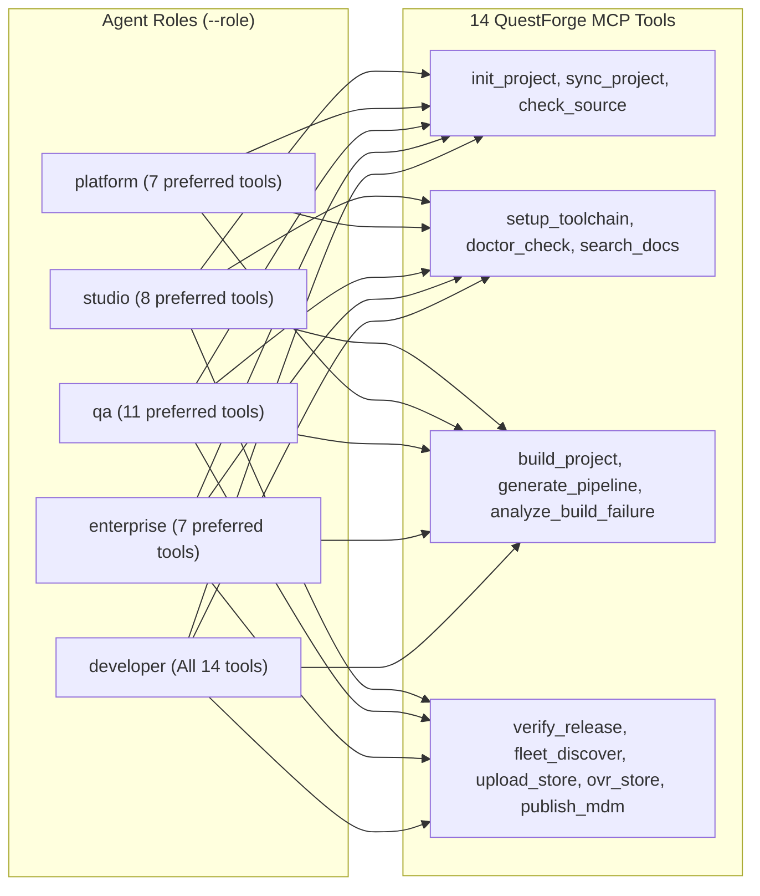

# Developer & AI Agent Workflow (`--role developer`)

**Audience**: AI-native XR creators, IDE coding agent authors, and QuestForge MCP integrators

**Target Persona:** AI-Native XR Creators and IDE coding assistants (Cursor, Claude Code, VS Code MCP clients, or `quest agent --role developer`) orchestrating all 14 QuestForge tools over JSON-RPC 2.0 (`quest mcp`).

---

## Table of Contents

- [1. AI Agent ReAct & MCP Sequence](#1-ai-agent-react--mcp-sequence)
- [2. Role-Scoped MCP Tool Matrix (14 Tools)](#2-role-scoped-mcp-tool-matrix-14-tools)

---

## 1. AI Agent ReAct & MCP Sequence

---

## 2. Role-Scoped MCP Tool Matrix (14 Tools)

`quest agent --role <role>` filters and prioritizes the MCP tools exposed to the LLM (`AgentRole::preferred_tools`) so each role operates within its domain boundary, while `--role developer` exposes the full 14-tool surface:

| MCP Tool | Purpose |
|---|---|
| `doctor_check` | Executes `QD-001`–`QD-009` (supports `fix: true`) and returns structured JSON diagnostics |
| `sync_project` | Synchronizes `quest_forge.yaml` and `specs/*_xr.yaml` into `AndroidManifest.xml`, `QuestForgeBootstrap.gen.*`, and scene bindings |
| `check_source` | Runs sub-second static source gates (`QF-SPEC-001`, `QF-SYNC-001`, `QF-VRC-001`, `QF-OXR-001`, `QF-PERF-001`) |
| `init_project` | Scaffolds a Unity, Unreal, or Native Rust OpenXR Quest project |
| `build_project` | Executes `CiOrchestrator` to produce an APK, metadata, and CycloneDX SBOM |
| `verify_release` | Runs `QV-001`–`QV-006` static VRC verification on an `.apk` |
| `generate_pipeline` | Emits GitHub Actions, Azure DevOps, or Jenkins pipeline definitions |
| `analyze_build_failure` | Classifies Unity, Unreal, Gradle, NDK, IL2CPP, and signing errors |
| `search_docs` | Searches QuestForge VRC, doctor, and configuration documentation |
| `fleet_discover` | Discovers connected Quest headsets or emulators over `adb` |
| `publish_mdm` | Publishes verified APKs to Meta HMS (`graph.oculus.com`), ManageXR (`managexrapi.com`), or ArborXR (`api.xrdm.app`) |
| `setup_toolchain` | Provisions and SHA-256-verifies `adb`, `cmdline-tools`, and `ovr-platform-util` (`quest setup`) |
| `upload_store` | Uploads a signed `.apk` to a Meta Horizon Store release channel (`ALPHA`, `BETA`, `RC`, `PRODUCTION`) |
| `ovr_store` | 1:1 `ovr-platform-util` Horizon Store control (`upload-quest-build`, `download-quest-build`, `get-release-channel-data`, `set-release-channel-build`, `download-asset-file`, `version`) |
