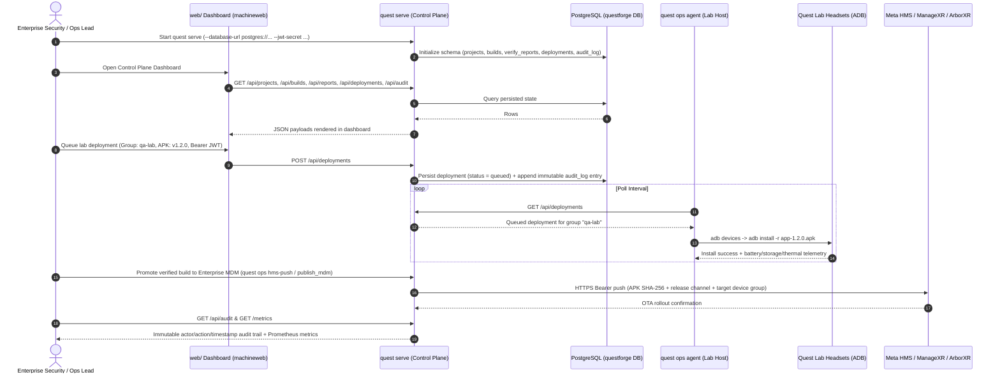
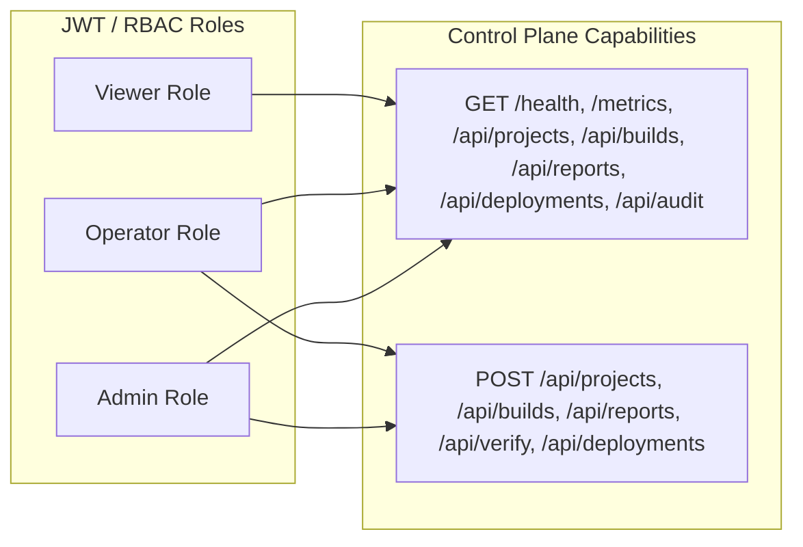

# Enterprise Security & Operations Workflow (`--role enterprise`)

**Target Persona:** Enterprise Security, Compliance, and Lab Operations Leads running the **QuestForge Control Plane** (`quest serve` + `web/` dashboard) backed by PostgreSQL, enforcing JWT RBAC and immutable audit logs, and rolling out verified builds to enterprise headset fleets via **Meta HMS (`graph.oculus.com`)**, **ManageXR (`managexrapi.com`)**, or **ArborXR (`api.xrdm.app`)**.

---

## 1. Enterprise Control Plane, Lab Agent & MDM Sequence

---

## 2. RBAC Permission Matrix

See the **[Operations Runbook](../../6-operations/runbook.md)** for full Control Plane, PostgreSQL, JWT, and Enterprise MDM commands.
