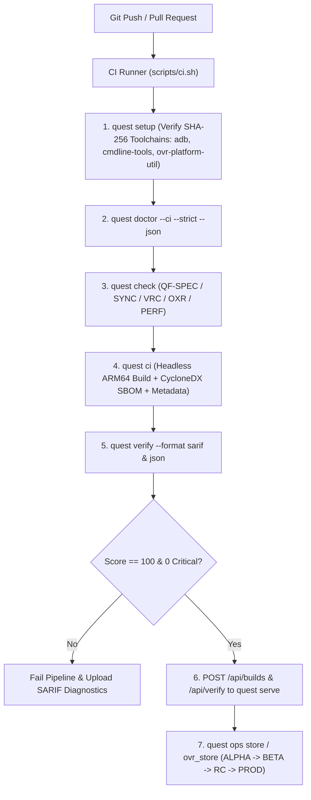
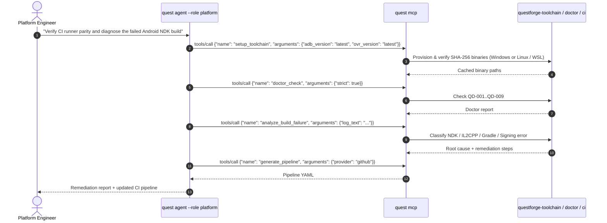

# Platform & DevOps Workflow (`--role platform`)

**Audience**: Platform engineers, CI/CD maintainers, and DevOps leads

**Target Persona:** Platform & DevOps Engineers standardizing Quest CI/CD across GitHub Actions, Azure DevOps, or Jenkins with zero-trust SHA-256 binary provisioning, CycloneDX 1.5 SBOMs, and SARIF compliance gates.

---

## Table of Contents

- [1. Provider-Agnostic CI/CD Pipeline Flow](#1-provider-agnostic-cicd-pipeline-flow)
- [2. Build Failure Diagnostics & Remediation Loop](#2-build-failure-diagnostics--remediation-loop)

---

## 1. Provider-Agnostic CI/CD Pipeline Flow

---

## 2. Build Failure Diagnostics & Remediation Loop

See the **[Operations Runbook](../../6-operations/runbook.md)** for full CI and workstation commands.
