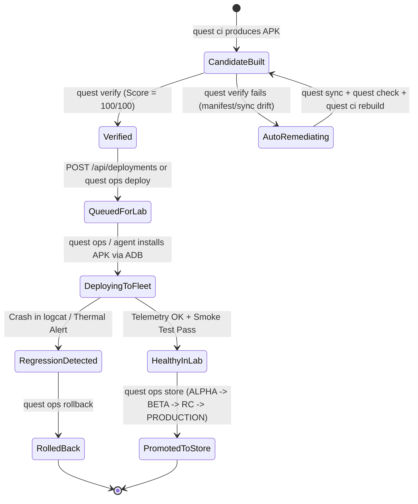
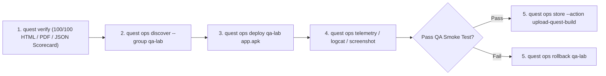

# QA & Release Workflow (`--role qa`)

**Audience**: XR QA engineers, release managers, and lab fleet operators

**Target Persona:** XR QA & Release Managers auditing `0–100` Meta Horizon VRC scorecards, autonomously remediating manifest/sync drift (`sync_project` → `build_project` → `verify_release`), deploying candidate APKs to lab headset fleets, and promoting verified builds to Meta Horizon Store release channels.

---

## Table of Contents

- [1. QA Release Readiness State Machine](#1-qa-release-readiness-state-machine)
- [2. QA Fleet Validation & Horizon Store Promotion Flow](#2-qa-fleet-validation--horizon-store-promotion-flow)
- [3. Autonomous QA Agent Remediation & Store Upload Sequence](#3-autonomous-qa-agent-remediation--store-upload-sequence)

---

## 1. QA Release Readiness State Machine



---

## 2. QA Fleet Validation & Horizon Store Promotion Flow



---

## 3. Autonomous QA Agent Remediation & Store Upload Sequence

```mermaid
sequenceDiagram
    autonumber
    actor QA as QA & Release Manager
    participant Agent as quest agent --role qa
    participant MCP as quest mcp
    participant Core as Verify / Init / CI / Ops Crates
    participant Store as Meta Horizon Store (ovr-platform-util)

    QA->>Agent: "Verify dist/app.apk; if below 100/100 fix and rebuild, then upload to ALPHA"
    Agent->>MCP: tools/call {"name": "verify_release", "arguments": {"apk_path": "dist/app.apk"}}
    MCP->>Core: ApkVerifier::verify (QV-001..QV-006)
    Core-->>MCP: Score < 100 (or 100/100)
    opt If manifest or sync drift detected
        Agent->>MCP: tools/call {"name": "sync_project", "arguments": {}}
        Agent->>MCP: tools/call {"name": "check_source", "arguments": {}}
        Agent->>MCP: tools/call {"name": "build_project", "arguments": {"release_version": "1.0.1"}}
        Agent->>MCP: tools/call {"name": "verify_release", "arguments": {"apk_path": "dist/app-1.0.1.apk"}}
        Core-->>MCP: Score 100/100 (READY)
    end
    Agent->>MCP: tools/call {"name": "ovr_store", "arguments": {"action": "upload-quest-build", "channel": "ALPHA"}}
    MCP->>Core: Provision ovr-platform-util (if missing) & translate WSL paths if on WSL
    Core->>Store: ovr-platform-util upload-quest-build --apk ... --channel ALPHA
    Store-->>Core: Upload complete
    MCP-->>Agent: Store upload report + SHA-256
    Agent-->>QA: Confirmed 100/100 VRC compliance & ALPHA channel upload
```

See the **[Operations Runbook](../../6-operations/runbook.md)** for full QA fleet and Horizon Store commands.
