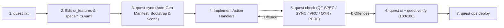
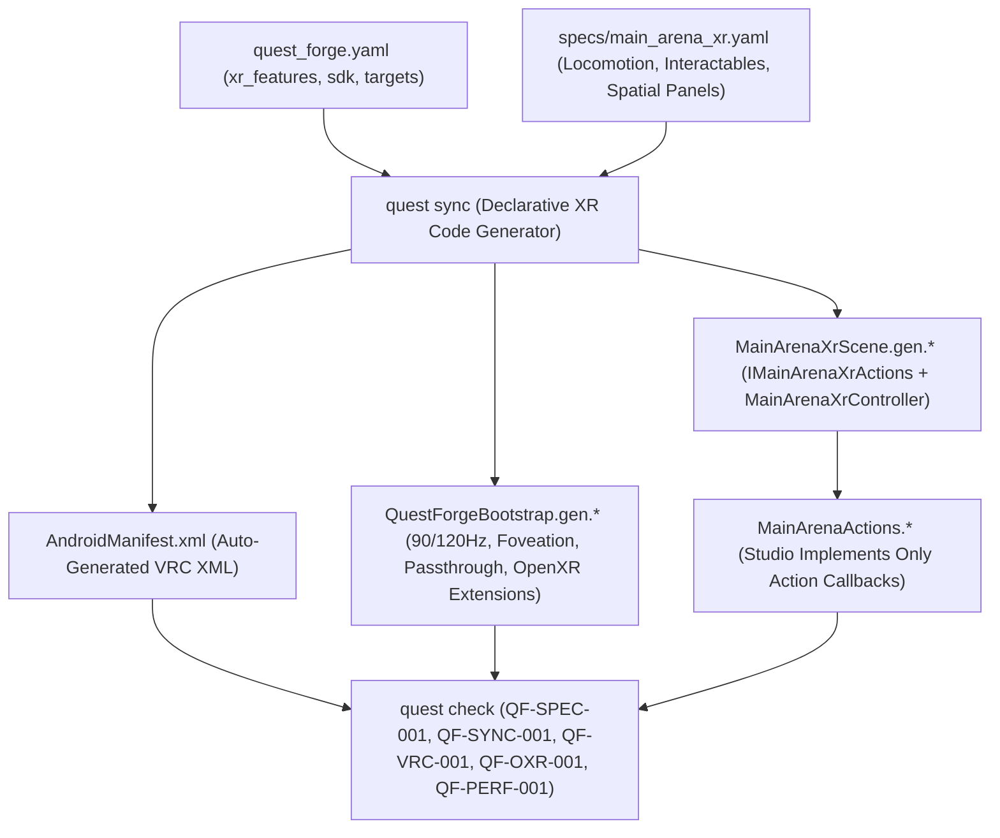
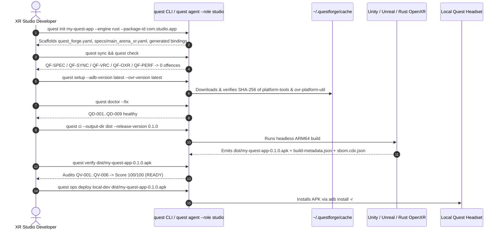

# Studio Workflow (`--role studio`)

**Audience**: XR Game Studios and Unity / Unreal / Native Rust OpenXR developers

**Target Persona:** XR Game Studios building for Meta Quest with **Unity (`engine: unity`)**, **Unreal Engine (`engine: unreal`)**, or **Native Rust OpenXR (`engine: rust`)**.

---

## Table of Contents

- [1. Studio Inner-Loop Flow](#1-studio-inner-loop-flow)
- [2. Declarative XR Codegen Architecture (`quest sync` & `quest check`)](#2-declarative-xr-codegen-architecture-quest-sync--quest-check)
- [3. End-to-End Studio Sequence](#3-end-to-end-studio-sequence)

---

## 1. Studio Inner-Loop Flow

---

## 2. Declarative XR Codegen Architecture (`quest sync` & `quest check`)

QuestForge generates engine manifests, `AndroidManifest.xml`, runtime OpenXR session/extension startup code, and strongly-typed scene interaction controllers directly from `quest_forge.yaml` and `specs/*_xr.yaml`:

### Multi-Engine Codegen Matrix

| Engine Target | Status | `quest_forge.yaml` | Generated Bootstrap | Generated Scene Code (`specs/*_xr.yaml`) | User Handler File |
|---|---|---|---|---|---|
| **Unity (C# / IL2CPP)** | **Shipped** | `engine: unity` | `Assets/Generated/QuestForgeBootstrap.gen.cs` | `Assets/Generated/<Scene>XrScene.gen.cs` | `Assets/Scripts/MainArenaActions.cs` |
| **Unreal Engine (C++)** | **Shipped** | `engine: unreal` | `Source/QuestForge/QuestForgeBootstrap.gen.h` | `Source/QuestForge/<Scene>XrScene.gen.h` | `Source/QuestForge/MainArenaActions.h` |
| **Native Rust OpenXR** | **Shipped** | `engine: rust` | `src/questforge_bootstrap_gen.rs` | `src/<scene>_xr_scene_gen.rs` | `src/main_arena_actions.rs` |
| **Godot 4 OpenXR** | **Roadmap (`#18`)** | `engine: godot` | `addons/questforge/bootstrap.gen.gd` | `addons/questforge/<scene>_xr_scene.gen.gd` | `scripts/main_arena_actions.gd` |
| **Native C++ OpenXR** | **Roadmap (`#18`)** | `engine: cpp` | `include/questforge_bootstrap.gen.hpp` | `include/<scene>_xr_scene.gen.hpp` | `src/main_arena_actions.cpp` |
| **WebXR + `wgpu` (`mweb`)** | **Roadmap (`#18`)** | `engine: webxr` | `src/generated/questforge_bootstrap.gen.ts` | `src/generated/<scene>_xr_scene.gen.ts` | `src/features/main_arena_actions.ts` |

---

## 3. End-to-End Studio Sequence

See the **[Developer Guide](../../4-development/developer_guide.md)** for full CLI commands.
